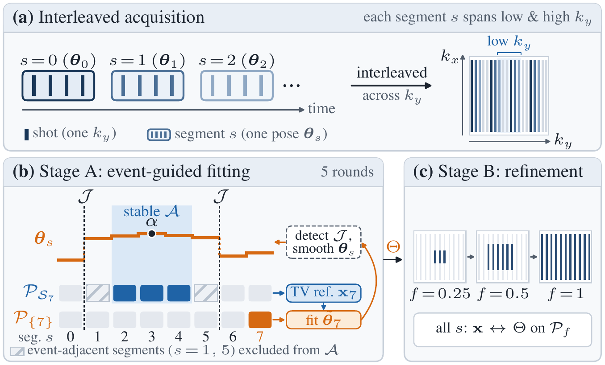
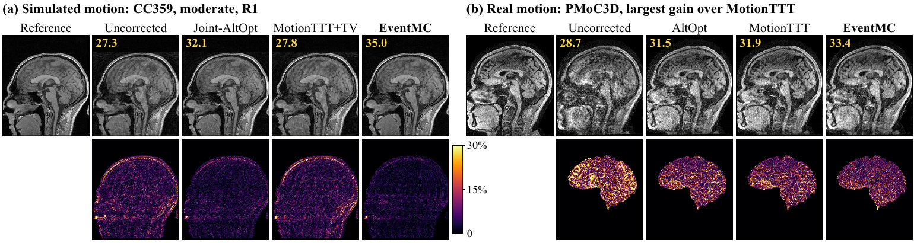

<div align="center">

# EventMC

**Training-free motion-corrected 3D brain MRI reconstruction via event-guided references**

Wei Jiang, Hongli Chen, Tianyi Ding, Feng Liu, Nan Ye, Hongfu Sun

<!-- After the arXiv preprint is announced, add its badge and link here. -->


[Results](#results) · [Installation](#installation) · [Quick start](#quick-start) · [How it works](#how-it-works) · [Citation](#citation)



<sub>(a) Interleaved acquisition: consecutive shots form segments with one pose each. (b) Stage A fits each segment to a
reference from the stable interval around the anchor, excluding segments next to detected events. (c) Stage B refines
the image and all poses from low to high spatial frequencies.</sub>

</div>

EventMC (event-guided motion correction) estimates rigid head motion and a motion-corrected image from multi-coil 3D
Cartesian k-space acquired in interleaved segments, **without any training data**. Each segment's pose is fitted against
a reference image reconstructed from a *stable interval*: consecutive segments between detected motion events, around
an anchor segment. The image and motion are then refined with all segments, from low to high spatial frequencies.

## Highlights

- **Training-free.** No training data or pretrained network; images are reconstructed with a total-variation prior.
- **Event-guided references.** Abrupt head movements are detected from the pose estimates themselves, and each
  segment is fitted against data from a stable part of the scan rather than against an image blurred by all motion
  states.
- **Physical forward model.** One rigid pose per segment, scanner-fixed coil sensitivities and rigid transforms by
  Fourier shears, so no interpolation kernels are needed.
- **Fast.** A single run takes under 7 min per scan (12 coils, 170 × 218 × 256) on one NVIDIA H100: up to 7.5 times
  faster than MotionTTT, with less than half the GPU memory.

## Results

**On simulated motion, EventMC gives the best image quality at full and two-fold sampling, up to 4.0 dB above MotionTTT
with the same final reconstruction. On real motion, its mean image quality is similar to MotionTTT's, without any
training.**

<div align="center">

</div>

Central sagittal slices with volumetric PSNR (dB) and absolute error maps: (a) simulated motion on CC359 at full
sampling; (b) real motion from PMoC3D, the scan with the largest gain over MotionTTT.

Mean PSNR (dB) from the paper (simulated moderate motion on nine CC359 subjects; 26 real-motion scans from PMoC3D):

| Method | CC359, R1 | CC359, R2 | CC359, R4 | PMoC3D (R ≈ 4.9) |
|---|:---:|:---:|:---:|:---:|
| MotionTTT | 27.4 | 27.2 | 31.6 | 32.6 |
| MotionTTT + our TV reconstruction | 30.8 | 29.9 | **32.6** | – |
| **EventMC** | **34.8** | **33.6** | 32.1 | **32.7** |

EventMC is clearly better at full and two-fold sampling. At four-fold undersampling it no longer outperforms
MotionTTT with our TV reconstruction, and on PMoC3D it is similar to MotionTTT, without any training (see
[Limitations](#limitations)).

## Installation

Requires Python 3.10+ and PyTorch 2.1+. A CUDA GPU is strongly recommended for full-size data.

```bash
git clone https://github.com/bayesbreeze/EventMC.git
cd EventMC
pip install -r requirements.txt
```

## Quick start

```python
from eventmc import run_eventmc

# y:        complex (C, D, H, W) multi-coil 3D k-space (coils, kz, ky, kx), zeros where not sampled
# segments: list of 1D int arrays, the ky indices of each segment in acquisition order
out = run_eventmc(y, segments, maps=None, voxel_mm=1.0)

image = out['image']   # complex (D, H, W), motion-corrected, in the anchor segment's head position
poses = out['poses']   # (N_s, 6): rotation vector (deg) and translation (mm) of each segment, relative to the anchor
```

| Option | Effect |
|---|---|
| `multi_anchor=False` | a single run of Algorithm 1 (EventMC-S): about 7 instead of 11–12 min per scan in the paper |
| `use_guard=False` | skips the within-segment check (needed when segments have only a few shots, as for PMoC3D) |
| `tv_weight` | TV weight for normalised data: `1e-3` (CC359 in the paper), `3e-3` (PMoC3D) |
| `maps`, `mask2d` | coil sensitivities and the (kz, ky) sampling pattern; estimated from `y` if omitted |

To check the installation, run the full pipeline on a small synthetic phantom:

```bash
python examples/synthetic_demo.py            # EventMC (multi-anchor), about 3 min on a GPU
python examples/synthetic_demo.py --single   # EventMC-S only
```

The phantom is much smaller and simpler than a brain, so its estimated motion does not indicate accuracy on real data.

## Input requirements

<details>
<summary>Acquisition, segments, coil sensitivities, voxels and scaling</summary>

| Item | Requirement |
|---|---|
| Acquisition | 3D Cartesian; each shot acquires one ky index (all kx, and the sampled kz of that ky) |
| Segments | time-contiguous groups of shots, one rigid pose each; every segment must sample both low and high spatial frequencies, i.e. its ky lines are spread over k-space (interleaved ordering) |
| Coil sensitivities | scanner-fixed; estimated from the low-frequency centre of `y` if not given |
| Voxels | isotropic, size `voxel_mm`; poses are in degrees and millimetres about the FOV centre |
| Scaling | with `normalize=True` (default), `y` is scaled so that the 99.5th percentile of the uncorrected magnitude is 1, the scale for which `tv_weight` is set |

</details>

## How it works

1. **Pre-run** — one Stage A round with a temporary mid-scan anchor detects motion events; the anchor is placed in the
   middle of the longest interval without events.
2. **Stage A: fitting to event-guided references** (5 rounds) — each segment's pose is fitted, from the nearest to the
   anchor to the farthest, against a TV reference built from the stable interval without the target's own data. Events
   are detected from the pose jumps, and the poses are smoothed except across events.
3. **Stage B: coarse-to-fine refinement** — one image and all poses are refined together on a growing central band of
   k-space, followed by a final reconstruction from all samples.
4. **Multi-anchor extension** — two more candidates with Stage A at half resolution, the second one at a second anchor;
   the candidate with the smallest full-data residual is kept.

<details>
<summary>Where each step of the paper is in the code</summary>

| Paper (Section / Algorithm 1) | Code |
|---|---|
| Forward model, Eq. (1); objective, Eq. (2) | `model.EncodingModel.encode`, `move` |
| ImgEst (TV reconstruction with fixed poses) | `model.EncodingModel.reconstruct` |
| MotEst (pose fit of one segment) | `model.EncodingModel.fit_pose` |
| Pre-run and anchor selection (Sec. 3.1, line 2) | `anchor.prerun`, `anchor.guard` |
| Reference segments, Eq. (3) | `stages.stable_interval`, `stages.stage_a` |
| Pose fitting and events | `model.EncodingModel.fit_poses_outward`, `events.detect_events`, `events.smooth_poses` |
| Stage B (Sec. 3.2, lines 9–13) | `stages.stage_b`, `stages.central_band` |
| Final reconstruction (line 14) | `stages.final_reconstruction` |
| Multi-anchor extension (Sec. 3.3) | `pipeline.half_resolution`, `pipeline.eventmc_half`, `pipeline.run_eventmc` |

</details>

## Repository layout

```
eventmc/
  params.py      algorithm parameters used in the paper
  model.py       forward model of the interleaved acquisition, ImgEst and MotEst
  events.py      event detection and event-aware pose smoothing
  stages.py      Stage A, Stage B and the final reconstruction (Algorithm 1)
  anchor.py      pre-run, within-segment check and anchor selection
  pipeline.py    EventMC-S and the multi-anchor extension (run_eventmc)
  fourier.py     centred FFTs and total variation
examples/
  synthetic_demo.py   installation check on a small phantom
```

## Parameters

All parameters are in [`eventmc/params.py`](eventmc/params.py).

<details>
<summary>Main parameters used in the paper</summary>

| Parameter | Value | Name |
|---|---|---|
| TV weight λ | 1e-3 (CC359); 3e-3 (PMoC3D, chosen by k-space cross-validation on motion-free scans) | `TV_WEIGHT` |
| Stage A rounds | 5 | `STAGE_A_ROUNDS` |
| Stage B bands | f = 0.25, 0.5, 1, 1 | `STAGE_B_SCHEDULE` |
| L-BFGS iterations | 15 per image update, 30 per pose fit, 30 for the final reconstruction | `IMAGE_ITERS`, `POSE_ITERS`, `FINAL_ITERS` |
| Event threshold | m_j > max(3σ_j, 0.6 mm), six probe points at 60 mm | `EVENT_*`, `PROBE_RADIUS_MM` |
| Pose smoothing | σ = 0.3, λ_sm = 1/0.15², Huber δ = 0.3 | `SMOOTH_*` |
| Within-segment check | 3 sub-windows per segment, 24 slices, z > 3, up to 5 rounds | `GUARD_*` |

</details>

## Limitations

- The TV prior limits performance under heavy undersampling (about four-fold and above).
- One pose per segment cannot represent motion within a segment, and frequent movements leave no long stable interval
  for the anchor.
- The multi-anchor extension ranks candidates by data residual, a heuristic that does not guarantee the lowest image
  error.

This repository contains the method. The data simulation, baselines and evaluation used for the paper's experiments
are not included.

## Citation

```bibtex
@misc{jiang2026eventmc,
  title  = {Training-free motion-corrected 3D brain MRI reconstruction via event-guided references},
  author = {Jiang, Wei and Chen, Hongli and Ding, Tianyi and Liu, Feng and Ye, Nan and Sun, Hongfu},
  year   = {2026},
  note   = {Preprint}
}
```

## License

MIT, see [LICENSE](LICENSE).
